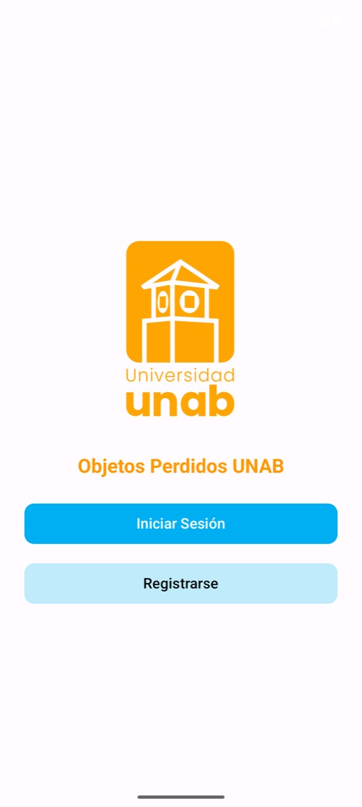
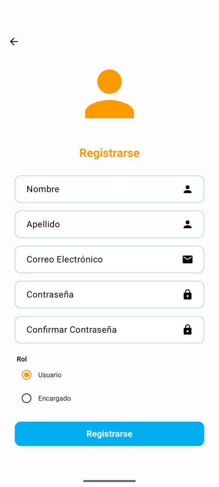
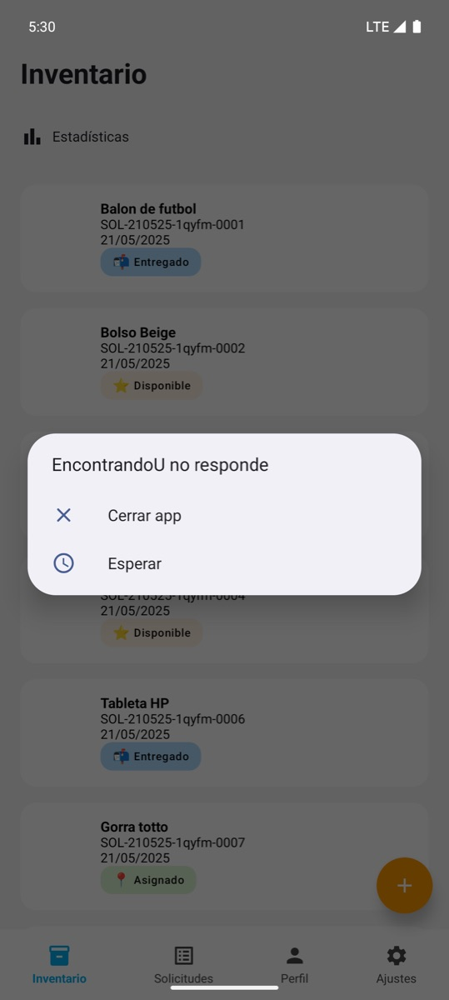
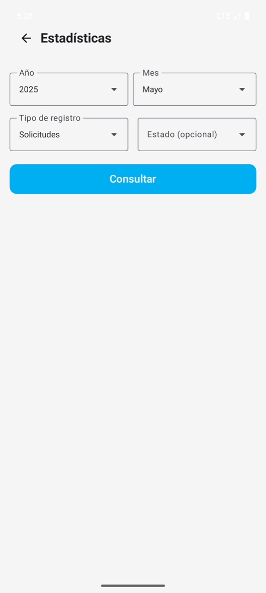

# EncontrandoU

App Android para gestionar objetos perdidos en el campus universitario. Los estudiantes reportan lo que perdieron y los encargados registran lo que encuentran, revisan las solicitudes y coordinan la devolución.

> **English summary:** Android app for lost-and-found management on a university campus, built with Kotlin and Jetpack Compose on Firebase (Auth, Firestore, Storage). Students file lost-item requests; staff register found items with photos, match them to requests, update their status and see statistics. MVVM architecture, unit tests and CI with GitHub Actions.


**Autora:** Leydy Yohana Macareo Fuentes
**Curso:** Desarrollo de Aplicaciones Móviles, UNAB, 2025
**Tecnologías:** Kotlin · Jetpack Compose · Material 3 · Navigation Compose · Firebase Auth, Firestore y Storage · Coil · JUnit · GitHub Actions

<p align="center">
  
  
  
  
</p>

## Qué hace

**Estudiante**
- Se registra con su correo institucional (@unab.edu.co).
- Crea solicitudes de objetos perdidos y sigue su estado.
- Ve un video de ayuda sobre cómo usar la app.

**Encargado**
- Registra objetos encontrados con foto, tomada con la cámara o desde la galería.
- Revisa las solicitudes, las asocia con objetos registrados y actualiza su estado.
- Consulta estadísticas por mes y por estado, con indicadores y gráficas.

## Arquitectura

Patrón MVVM con una sola actividad y navegación con Compose:

```
app/src/main/java/com/leydymacareo/encontrandou/
  screens/        Pantallas por rol: login, user (estudiante) y staff (encargado)
  components/     Componentes reutilizables de interfaz
  viewmodels/     Estado de sesión, solicitudes, estadísticas y configuración
  data/           Acceso a Firebase Storage (subida de imágenes)
  models/         Modelos de datos y estados
  navigation/     Rutas y grafo de navegación
  utils/          Validaciones de formularios y manejo de fechas
```

Los datos viven en tres colecciones de Firestore: `usuarios`, `solicitudes` y `objetos`. Las fotos se guardan en Firebase Storage.

## Pruebas

Las validaciones de formularios y el manejo de fechas tienen pruebas unitarias (`app/src/test`), que corren automáticamente en GitHub Actions con cada cambio.

```bash
./gradlew testDebugUnitTest
```

## Cómo ejecutarla

1. Crear un proyecto en [Firebase](https://console.firebase.google.com) y activar Authentication (correo y contraseña), Firestore y Storage.
2. Registrar una app Android con el paquete `com.leydymacareo.encontrandou` y descargar su `google-services.json` en la carpeta `app/`. Hay una plantilla en `app/google-services.json.example`.
3. Abrir el proyecto en Android Studio y ejecutarlo en un dispositivo o emulador con Android 8.0 o superior.

## Limitaciones conocidas

- Las fotos de los objetos se guardaban en Firebase Storage, que ya no está activo en el proyecto original, así que en las capturas no aparecen.
- El código de registro de encargados está fijo en la app. En una versión real, el rol de encargado se asignaría desde el servidor (por ejemplo, con reglas de Firestore o claims de Firebase Auth).
